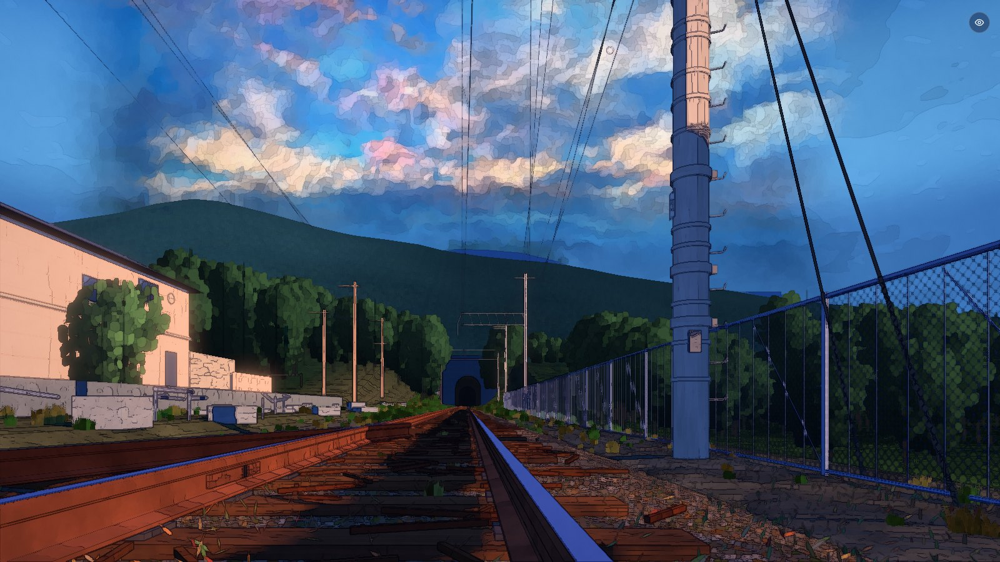
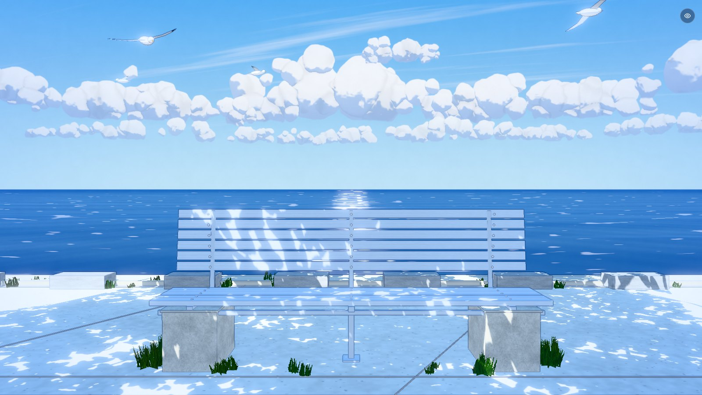

# 夏之隧道 · Summer Tunnel

两个**可切换、彼此独立**的程序化 3D 场景，用 Three.js 在浏览器里实时渲染，并以日系动画背景的风格呈现：

| 01 · 夏之隧道 | 02 · 海边长椅 |
| --- | --- |
|  |  |

在线访问（启用 GitHub Pages 后）：**https://zongruichd-rd.github.io/summer-tunnel-/**

- `#tunnel` → 直接打开隧道场景
- `#seaside` → 直接打开海边场景

## 场景内容

**01 · 夏之隧道**：通向山中隧道的单线铁路，按参考图一比一复刻构图。从参考图里测量出了镜头焦距、灭点、视点高度（眼睛只比钢轨高约 20 cm）和平移镜头（竖线保持竖直），每个物体都按它在原图中的像素位置反投影到 3D 空间里摆放。建模内容包括：

- 钢轨（按截面挤出）、枕木、垫板、道砟、旁边废弃的侧线和车挡
- 编号为「3」的接触网立柱：腕臂、斜撑、绝缘子、脚钉
- 沿线的承力索、接触线和吊弦，以及配电线杆和馈线
- 铁丝网围栏、民房、混凝土排水沟
- 隧道洞门、翼墙和逐渐变暗的隧道内部
- 按原图描出的山脊轮廓建成的山体，以及远处的山脉
- 傍晚的天空：云的布局和颜色取自原图的一张粗略色彩分布图（96×80），细节由程序生成

**02 · 海边长椅**：海堤上的一张长椅。建模内容包括：

- 长椅：混凝土底座、木条坐板和靠背、金属支架、螺钉
- 地砖步道、海堤和一排矮石墩
- 带波浪和太阳光斑反光路径的大海
- 地平线上的积云带，以及几只拍翅、滑翔、盘旋的海鸥
- 头顶（画面外）的树叶投下的、随风晃动的斑驳光影

两个场景各自有独立的 `THREE.Scene`、灯光、天空和后期参数。切换时用一个水彩晕染式的过渡效果。

## 操作

| 操作 | 桌面端 | 移动端 |
| --- | --- | --- |
| 环顾 | 拖动 | 单指拖动 |
| 缩放 | 滚轮 | 双指捏合 |
| 复位视角 | 双击 / `R` | 双击 / 「复位」按钮 |
| 切换场景 | `1` / `2`、`←` / `→`、底部标签 | 底部标签 |
| 自由视角（环绕整个 3D 模型） | `F` / 「自由视角」按钮 | 「自由视角」按钮 |
| 隐藏界面 | `H` / 眼睛按钮 | 眼睛按钮 |

画质会根据设备自动选择，也可以用 `?q=low`、`?q=medium` 或 `?q=high` 手动指定。如果帧率偏低，页面还会自动降低渲染分辨率。

## 实现要点

- **全部程序化**：没有外部模型或图片素材。几何体、纹理（道砟、木纹、混凝土、锈迹、草、树叶等）都在页面加载时用代码生成。
- **动画感着色**：基于 `MeshToonMaterial` 的平滑二阶光照，阴影带蓝色调；树冠用 3D 噪声扰动法线，呈现斑驳的光影。
- **描线**：后期中对深度缓冲的 1/z 做拉普拉斯运算来检测轮廓和折痕。草地等材质可以通过 alpha 通道单独关闭描线。
- **绘画质感**：场景一另加 Kuwahara 滤镜和色块边缘描线，模仿原图那种色块分明、带墨线的画法。
- **天空**：
  - 天空球着色器负责渐变、水彩质感和鱼鳞状高积云。
  - 积云的形状由大量「云团」叠成的高度场生成，加载时会烘焙成纹理，之后作为无限远的公告板绘制。
- **电线**：朝向相机的条带，近处保留真实粗细，远处保持至少约 1 像素宽并按覆盖率淡出，避免锯齿和断线。
- **海面**：海面着色器包括多方向波浪、菲涅尔反射天空、水平笔触，以及太阳下方的闪烁光路。
- **后期**：4× MSAA HDR 渲染目标 → 泛光 → 描线 → PBR Neutral 色调映射 → 调色 / 暗角 / 纸张颗粒。

## 本地运行

ES module 需要通过 HTTP 访问，不能直接双击打开 `index.html`：

```bash
python3 -m http.server 8080
# 或
npx serve .
```

然后打开 <http://localhost:8080/>。

## 部署到 GitHub Pages

仓库自带 `.github/workflows/pages.yml`，推送到 `main` 后会自动发布。第一次只需要在仓库里设置一次：

1. 打开 **Settings → Pages**
2. 把 **Build and deployment → Source** 选为 **GitHub Actions**
3. 到 **Actions** 页重新运行「Deploy to GitHub Pages」，或者再推送一次

页面只用相对路径，也可以直接选 **Deploy from a branch → `main` / `(root)`**。

## 目录结构

```
index.html            页面与界面
style.css             界面样式
src/main.js           渲染器、场景切换、交互、自适应分辨率
src/scenes/tunnel.js  场景一：铁路与隧道
src/scenes/seaside.js 场景二：海边长椅
src/lib/              材质、天空与云、电线、后期管线、纹理生成、几何工具
vendor/three/         Three.js r169（MIT）
assets/               README 预览图
```

## 致谢

- 两个场景参照了用户提供的两张动画风格插画，3D 内容是根据这两张图重新建模的。
- [Three.js](https://threejs.org/)（MIT License，见 `vendor/three/LICENSE`）。
